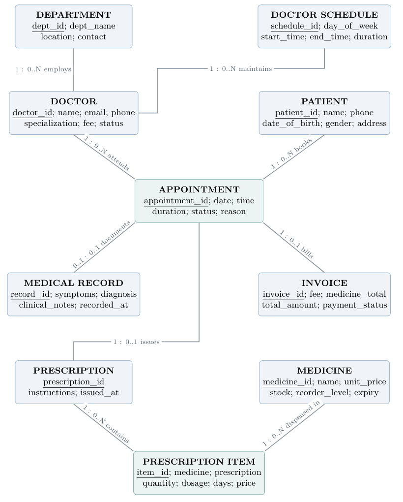
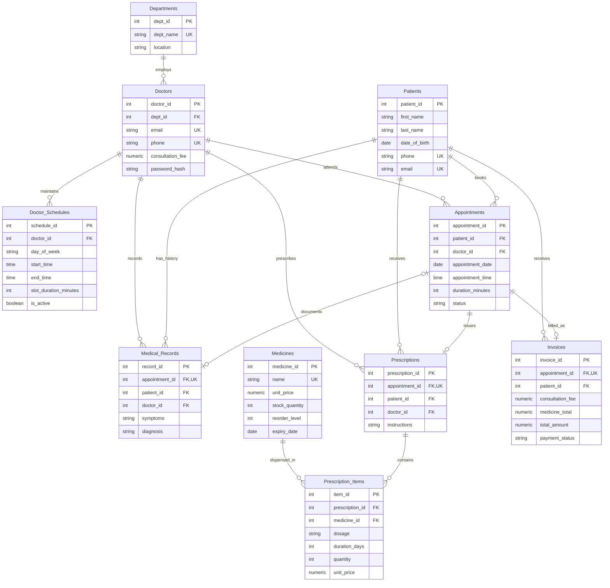

# MedConnect: Database Design & System Architecture Specification

**Final implementation | Group-11 | P2 Section | PostgreSQL 16**

## 1. Requirements, Personas & Assumptions

MedConnect manages an outpatient visit from patient registration through booking, clinical notes, medicine dispensing, invoice issue, and payment reporting. The ten relations are retained from the mid-sem design. Final additions are `Doctors.password_hash`, `Appointments.duration_minutes`, and `Prescription_Items.unit_price`.

Admin/Receptionist manages registry, booking, pharmacy, payments, and reports. Doctor views assigned appointments and their own clinical records, starts consultations, and completes encounters. Patients are records rather than login users. The single administration identity is configured outside the database; doctor credentials are hashed in the provider relation.

The clinic uses Asia/Kolkata time and INR. A provider belongs to one department. Weekly shifts stay within a single day, cannot overlap when active, and offer 15/20/30/45/60-minute slots. The seed uses 30-minute shifts. Appointment duration is captured from the selected shift. An appointment has at most one medical record, prescription header, and invoice. A prescription contains distinct medicine lines. Nullable appointment links permit legacy medical records.

## 2. Conceptual ER Model & Participation

The full attribute-level [relational schema diagram](diagrams/final_relational_schema.svg) is generated from `schema.sql` by `scripts/render_schema.py`.

The diagram lists key attributes; the full attribute catalog is in the final PDF and `schema.sql`. All entities have independent surrogate identifiers. A dependent relation is not automatically a weak entity in the identifying-key sense. No user ISA/specialization table is implemented. The Prescription–Medicine M:N relationship is decomposed into `Prescription_Items` with a unique prescription/medicine pair. The relational model permits a zero-line prescription header; the API creates a header only when lines are present, and writes header/lines atomically.

Each doctor/schedule/appointment/prescription/item/invoice must have its specified parent references. A parent may have zero children. A record may have zero or one appointment; an appointment may have zero or one record. Multiple records may have null appointment links. Patient and doctor provenance links remain mandatory even for these imported records.

## 3. Relational Mapping, Keys & Domains

| Relation | Primary key | Additional uniqueness | Foreign keys |
|---|---|---|---|
| Departments | dept_id | dept_name | — |
| Doctors | doctor_id | email; phone | dept_id → Departments |
| Doctor_Schedules | schedule_id | (doctor_id, day_of_week, start_time) | doctor_id → Doctors |
| Patients | patient_id | phone; non-null email | — |
| Appointments | appointment_id | partial active doctor/date/time index | patient_id → Patients; doctor_id → Doctors |
| Medical_Records | record_id | non-null appointment_id | appointment_id → Appointments; patient_id → Patients; doctor_id → Doctors |
| Prescriptions | prescription_id | appointment_id | appointment_id → Appointments; patient_id → Patients; doctor_id → Doctors |
| Medicines | medicine_id | name | — |
| Prescription_Items | item_id | (prescription_id, medicine_id) | prescription_id → Prescriptions; medicine_id → Medicines |
| Invoices | invoice_id | appointment_id | appointment_id → Appointments; patient_id → Patients |

Uniqueness of doctor and patient contact fields is enforced **within each relation**, not globally across both tables. Nullable UNIQUE columns allow multiple nulls. The partial appointment key excludes Cancelled rows, so it is not an unconditional candidate key over the whole appointment relation.

Identifiers and counts use integers; monetary values use exact `NUMERIC(10,2)`; dates use `DATE`; slot/shift times use local `TIME`; event timestamps use `TIMESTAMPTZ`; bounded strings cover names/status/contact fields and `TEXT` covers notes. `schema.sql` defines defaults, nullability, string limits, and allowed values. Birth dates have a static 1900 lower bound in the database and a no-future check in the API.

Patient phone and non-null emergency-contact values must match `^[0-9]{10}$`. They remain string columns to preserve leading zeroes. The interface shows the Indian `+91` prefix separately; it is not stored in either column. CHECK constraints and request validation enforce the same national-number rule without a mobile-only first-digit restriction. `database/migrations/001_patient_phone_numbers.sql` adds these constraints to existing installations without rewriting records.

### Referential Actions & Retention

There are 14 foreign keys. Parent deletes use RESTRICT except schedule-to-doctor and item-to-prescription CASCADE, and nullable record-to-appointment SET NULL. All FKs use ON UPDATE CASCADE. Final retention triggers additionally reject deletion of schedules, appointments, records, prescriptions, dispenses, and invoices, and reject updates to clinical records/prescriptions/dispenses. Thus the inherited cascade actions are not a supported route to remove clinical history. Patient deletion is appropriate only before any linked history exists.

## 4. Integrity Constraints & Lifecycle

| Concern | Database behavior | Application behavior |
|---|---|---|
| Domains | allowed statuses/categories/gender/blood group; nonnegative fees/prices/stock; positive quantity/days; ordered shifts | request types, bounded text, date validation, positive IDs |
| Booking | doctor row lock; active provider; weekday shift/alignment; captured duration; overlap scan; partial uniqueness | future-time validation; availability display; HTTP 409 with refresh |
| Status | Scheduled → In_Consultation → Completed, or Scheduled → Cancelled/No_Show; record required for completion | treating doctor owns start/complete; reception owns cancellation/no-show; future no-show rejected |
| Clinical provenance | inserted patient/doctor IDs must equal appointment identity and appointment must be open | insert IDs from locked appointment rather than user-supplied identities |
| Pharmacy | lock medicine; reject expired/insufficient stock; snapshot unit price; deduct quantity; unique line pair | stable medicine-ID insertion order; entire encounter is one transaction |
| Invoice | Completed status; matching patient; fee and dispensed-total checks at issue; arithmetic CHECK; retained/frozen amounts | stored procedure call inside completion transaction |
| Payment | Pending → Paid; valid payment method and paid timestamp | locked row; same-method retry returns existing payment; conflicting retry rejected |

Only Scheduled visits may change their time/reason; patient/doctor identity cannot be reassigned. Completed/Cancelled/No_Show visits cannot be reopened. Schedules cannot be changed while the doctor has upcoming Scheduled/In_Consultation bookings. Clinical amendments and refunds require additional designs and are outside the supported workflows.

## 5. Normalization Justification

1. **1NF:** every stored attribute is atomic for the application; prescription lines form a separate relation. JSON medication arrays are produced by the history query, not stored in a clinical column.
2. **2NF:** surrogate keys identify complete tuples; the alternative `(prescription_id, medicine_id)` key determines dosage, days, quantity, and that dispense's price. There are no repeated medicine columns on a prescription.
3. **3NF:** department data is separated from providers, catalog data from dispenses, and patient profiles from visits. Under the stated business assumptions, department, provider, patient, schedule, appointment, medicine, and dispense determinants are their keys.
4. **Conditional keys:** nullable unique appointment links in medical records are unique only when present. Multiple legacy rows may have no appointment, so that nullable attribute is not an unconditional classical candidate key.
5. **Controlled redundancy:** record/prescription header IDs repeat the linked appointment identity for provenance and patient/doctor indexing. Matching is enforced at insertion; subsequent supported edits are blocked. The invoice's patient ID is determined by its unique appointment. The stored `total_amount` is a deliberate derived value with non-key FD `(consultation_fee, medicine_total) → total_amount`, maintained by CHECK. A universal BCNF claim for all stored relations is not made.
6. **Historical facts:** item price at dispensing and consultation fee at invoice issue are snapshots with their own time context. A later catalog price does not determine an earlier dispense price. These snapshots are necessary to avoid repricing historical bills.

The schema is derived from identified entities and relationships; no unverified claim of a universal lossless/dependency-preserving decomposition is needed. The practical checks are key enforcement, matching provenance, retained records, consistent stock, and stable invoices.

## 6. Three Workflows & Transaction Boundaries

### 6.1 Booking, Cancellation & Rebooking

Reception selects a patient, active doctor, and future available slot. One INSERT runs inside an explicit API transaction. The trigger locks the doctor and revalidates schedule and occupancy. Competing connections serialize per provider; partial uniqueness remains an additional identical-slot guard. Cancellation changes status without deleting history and releases occupancy. Availability reads do not reserve slots.

### 6.2 Clinical Encounter & Inventory

Doctor start locks the appointment and checks assignment. Completion locks the same appointment and validates In_Consultation status. It writes record, optional header, sorted items, Completed status, and invoice. Trigger deductions participate in the surrounding transaction. A later item failure rolls back earlier deductions and every new record. Medical history restricts doctor users to their own recorded encounters for an associated patient.

### 6.3 Invoice, Payment & Reporting

The procedure locks the appointment, requires Completed, and returns without creating another invoice if one exists. It sums `quantity * Prescription_Items.unit_price` and captures the doctor's current consultation fee. The invoice trigger independently validates expected issue amounts. Payment locks the invoice and records method/time once; the paid-only view and reports read committed results. Billed and collected revenue are explicitly distinguished.

Default transaction isolation is READ COMMITTED. Row locks protect the contested writes. Locks on medicine rows are acquired in sorted ID order by the completion endpoint. Serialization/deadlock errors roll back and produce a retryable HTTP conflict. Database owners remain able to alter/disable these routines; retention is not a cryptographic audit trail.

## 7. Five Non-Trivial Analytical SQL Queries

The executable SQL files are the canonical report definitions. The API uses the same files, and the frontend allows selecting and exporting report results.

| Query | Meaning | Main constructs |
|---|---|---|
| [01 Department revenue](../database/queries/01_department_revenue.sql) | Current calendar month's billed, collected, pending amounts, including zero-activity departments | four-relation joins, grouped CTE, FILTER, DENSE_RANK, SUM OVER, NULLIF |
| [02 Doctor performance](../database/queries/02_doctor_performance.sql) | Last 30 days through today; visit outcomes, collections, attendance among Completed/No_Show | outer joins, grouped/filtered aggregates, ratios |
| [03 Pharmacy reorder](../database/queries/03_pharmacy_reorder.sql) | Low/expired stock, last-30-day dispensing velocity, estimated days remaining | two CTEs, joins, CASE, guarded division |
| [04 Patient history](../database/queries/04_patient_history.sql) | Bound patient/optional doctor filter; records with dispensed medication snapshots | joins, correlated subquery, ordered JSON aggregation |
| [05 Peak demand](../database/queries/05_peak_demand.sql) | Last 90 days through today; weekday/hour bookings and no-show ratios | grouped CTE, date extraction, FILTER, RANK |

The department revenue view groups Paid invoices by department and invoice issue date; the overview's collected-today card uses payment date. The distinction matters when a bill is paid later than its issue date. Seed invoices are issued and paid (where applicable) when the seed runs, while seeded clinical visits cover the previous fourteen days.

## 8. Indexing, Reproducibility & Verification

Primary/unique keys provide their associated indexes. Additional indexes support provider/date/status booking queries, patient history by recorded time, prescription/medicine joins, low-stock/category access, and invoice patient/status/date filtering. Indexes are not a promise that the planner always avoids sequential scans; for small demo tables, sequential scans can be appropriate. Use EXPLAIN ANALYZE on a relevant query when discussing indexing in the viva.

The bootstrap creates schema and sample data atomically on a fresh database. Reset is explicit for disposable demo data. A fresh seed creates 1,308 rows: 6 departments, 15 doctors, 105 schedules, 180 patients, 300 appointments, 168 records, 168 prescriptions, 30 medicines, 168 items, and 168 invoices. Dates are relative to the database's clinic date, and uniqueness/stock rules are exercised during insertion.

The final report is authored/compiled in Overleaf and limited to five pages. Source is [overleaf/main.tex](overleaf/main.tex). [Verification](verification.md) distinguishes real PostgreSQL tests, browser observations, production build, and any environment limits. [The demo guide](demo_guide.md) maps each workflow to the SQL/routines for individual explanation.
